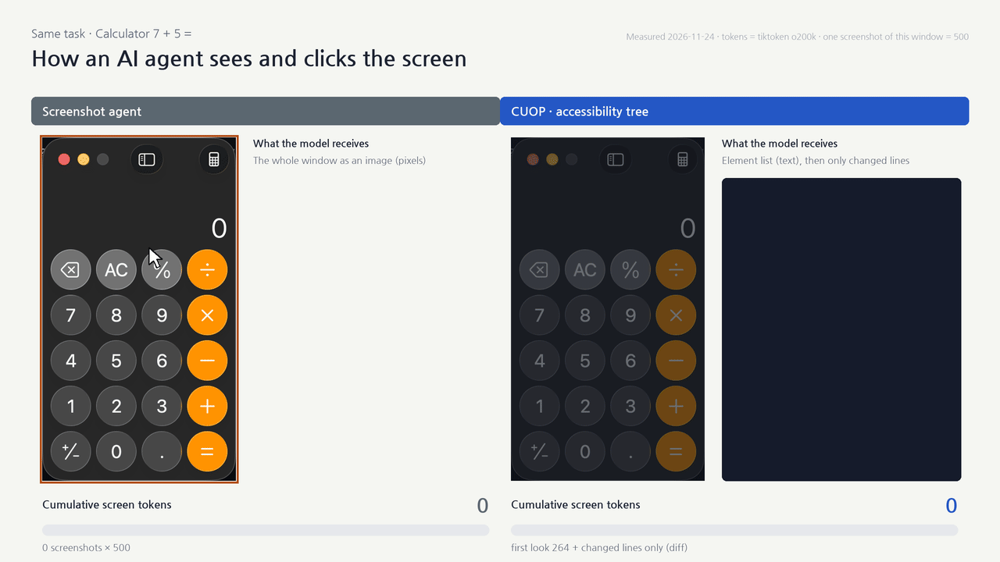
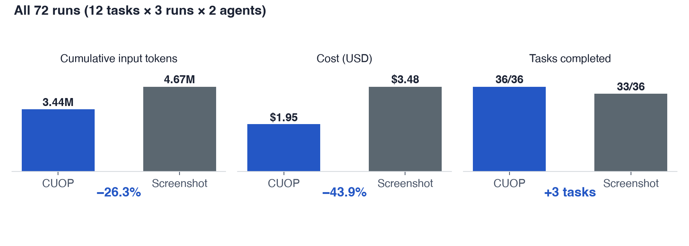
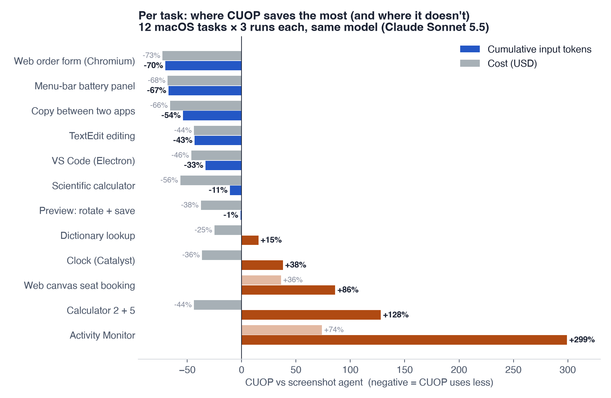
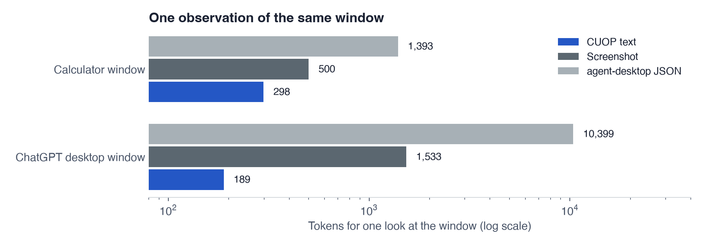

# ComputerUseOptimizer (CUOP)

**Computer use for AI agents that reads the macOS accessibility tree instead of screenshots — and sends only what changed.**

A screenshot agent pays for a full image of the screen at every step, then guesses pixel coordinates to click.
CUOP gives the agent a compact text list of the elements on screen, lets it act on an element by reference
(`click @s1:e14`), and after each action returns only the lines that changed.



*Same task (Calculator 7 + 5 =). Left: the screenshot agent receives a new image every step and clicks guessed coordinates.
Right: CUOP sends the element list once (264 tokens), then only the changed lines — 391 tokens in total instead of 2,500.*

## Results

All numbers below come from real runs on one MacBook (macOS 26), with the same model and the same prompt for both
agents. Tokens are counted with `tiktoken` (o200k); screenshots are scaled the way the API scales them.

### 12 real desktop tasks × 3 runs each



| | CUOP | Screenshot agent | Difference |
|---|---|---|---|
| Tasks completed | **36 / 36** | 33 / 36 | +3 |
| Cumulative input tokens | **3.44 M** | 4.67 M | **−26.3%** |
| Cost (API prices) | **$1.95** | $3.48 | **−43.9%** |

### Where it saves the most

The longer the task, the larger the saving: a screenshot agent re-sends a full image at every step, while CUOP sends
a small diff.



| Task (3 runs each) | Input tokens saved | Cost saved |
|---|---|---|
| Fill a multi-step web order form (Chromium) | **−70%** (413k → 123k) | −73% |
| Menu-bar battery panel¹ | −67% | −68% |
| Copy data between two apps | **−54%** (363k → 167k) | −66% |
| Edit a document in TextEdit | **−43%** (240k → 136k) | −44% |
| Edit a file in VS Code (Electron) | −33% | −46% |
| Scientific calculator | −11% | −56% |

¹ The screenshot agent failed this task 3/3 (another window covered the menu-bar item it tried to click), so the saving
is measured against failed runs.

Cost is lower in 10 of the 12 tasks. Short tasks (2–5 steps: Calculator, Clock, Activity Monitor) use *more* input
tokens with CUOP, because the tool definitions are re-read every turn and outweigh the small screen; the `core`
toolset (24 tools) cuts that fixed cost from 10.4k to 3.0k tokens. A canvas page has no tree content, so CUOP falls
back to a screenshot there.

### One look at one window



[vercel-labs/agent-desktop](https://github.com/vercel-labs/agent-desktop) returns the tree as JSON. CUOP keeps the
same commands and refs but renders the tree as one line per element and trims it to a token budget, so a content-heavy
window like the ChatGPT app costs 189 tokens instead of 10,399.

### Coverage

84 of the 102 GUI apps installed on the test Mac (82.4%) passed the coverage probe: at least five named, actionable
elements reach the model, and the text is cheaper than a screenshot of the same window. The median app costs 0.32× a
screenshot.

## How it works

```
Claude Code / Codex ──MCP──▶ cuop server ──▶ macOS Accessibility (AXUIElement) / Chrome DevTools ──▶ the app
                              │
                              ├─ text tree   one line per element:  e14 button "7"
                              ├─ refs        act by reference:       click @s1:e14
                              ├─ diff        after an action, only changed lines:  ~ e9 "7"
                              ├─ filter      a `goal` ranks elements relevant to the current step
                              └─ budget      large windows collapse to a skeleton instead of a full dump
```

- **agent-desktop compatible.** The commands, JSON envelope (`version 2.6`), error codes and ref format follow
  agent-desktop, so `--format json` output looks the same. `--format text` is the token-cheap form.
- **Headless by default.** Actions use the accessibility API without moving the user's mouse or stealing focus.
  `--headed` allows real key and mouse input for apps that ignore semantic input.
- **Progress you can watch.** An optional click-through overlay shows the current step and target, and a session trace
  can be exported as an HTML viewer.
- **Electron / Chromium.** Accessibility is switched on automatically (`AXManualAccessibility`,
  `AXEnhancedUserInterface`).
- **Optional Jev plugin.** With a TypeSafe Jev key, a small decision model ranks elements and suggests the route
  (tree, keys or screenshot) for the first view. Off by default.

## Quick start (macOS)

Requires macOS, Python 3.14 and [uv](https://docs.astral.sh/uv/). Grant Accessibility (and, for screenshots, Screen
Recording) to the terminal that runs it.

```bash
git clone https://github.com/csk200387/ComputerUseOptimizer.git
cd ComputerUseOptimizer
uv sync
uv run cuop permissions            # check Accessibility / Screen Recording
uv run cuop snapshot --app Calculator --format text
uv run cuop click @<snapshot-id>:e14 --format text   # returns the diff
```

Use it from an agent as an MCP server:

```bash
# Claude Code
claude mcp add cuop -- uv run --directory /path/to/ComputerUseOptimizer cuop mcp --format text --toolset core
```

The agent guide lives in [`skills/cuop/SKILL.md`](skills/cuop/SKILL.md) (`cuop skills` prints it).

## Limitations

- **macOS only** for now. Windows (UI Automation) is planned.
- **Apps that keep their content out of the tree.** Excel's cell grid, PowerPoint's slide canvas and drawing canvases
  are not in the accessibility tree; there a screenshot agent is still cheaper (Excel: $0.037 vs $0.122 per task).
- **Short tasks** pay the fixed cost of tool definitions; use `--toolset core`.
- **Small samples.** Each comparison ran 3 times per task; run-to-run variance can reach ±20%.

## Status

A university project (2026-2). The command surface is tracked against agent-desktop in
[`docs/parity/PARITY.md`](docs/parity/PARITY.md). Tests: `uv run pytest -q`.

## License

[Apache License 2.0](LICENSE). The command set and JSON contract follow
[vercel-labs/agent-desktop](https://github.com/vercel-labs/agent-desktop) (Apache-2.0); see [NOTICE](NOTICE).
